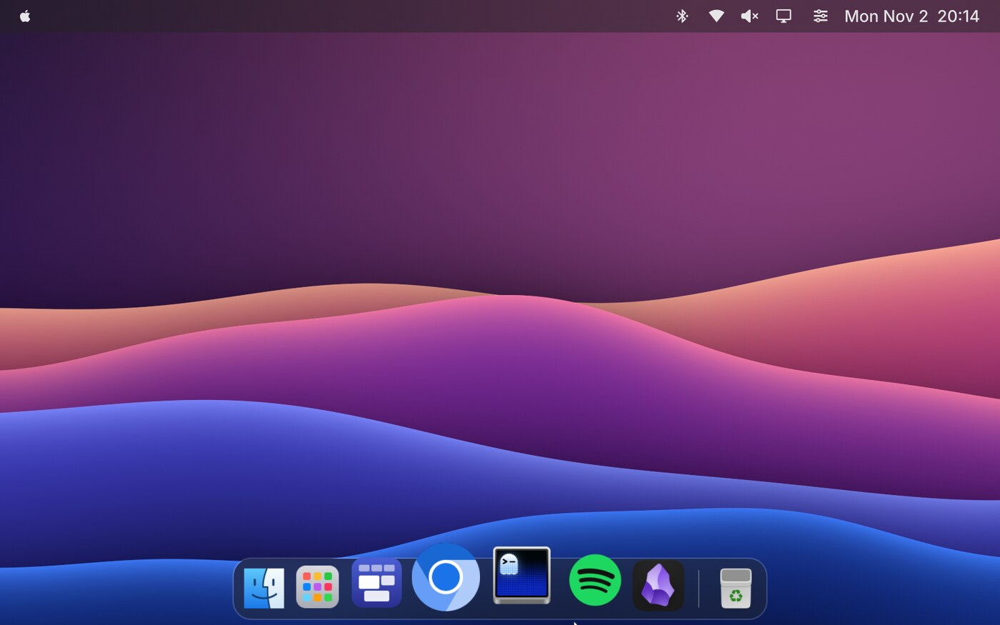
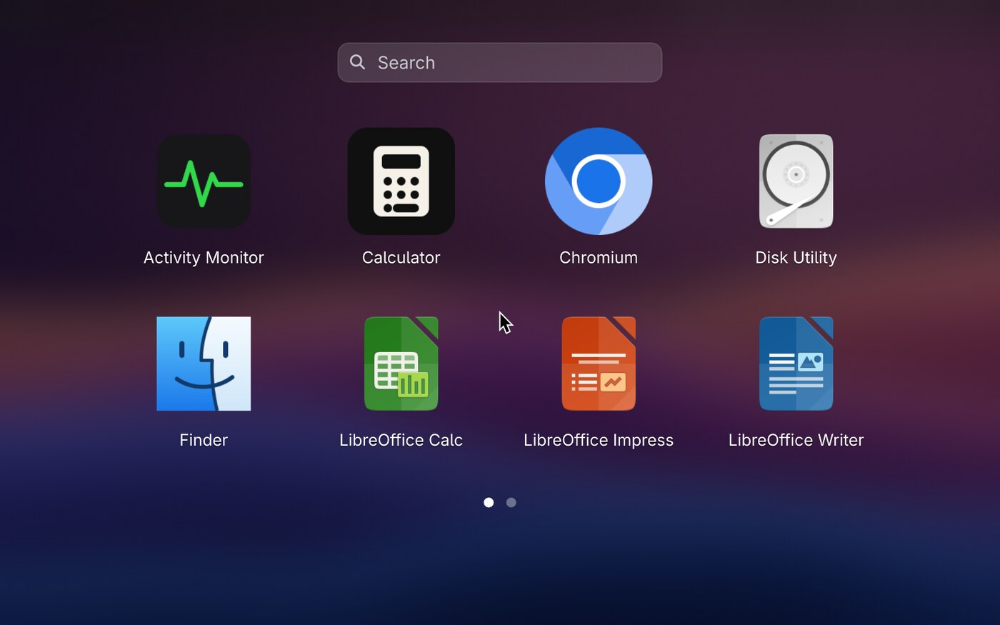
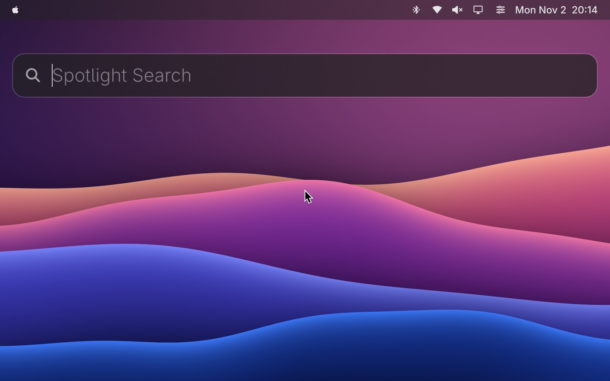
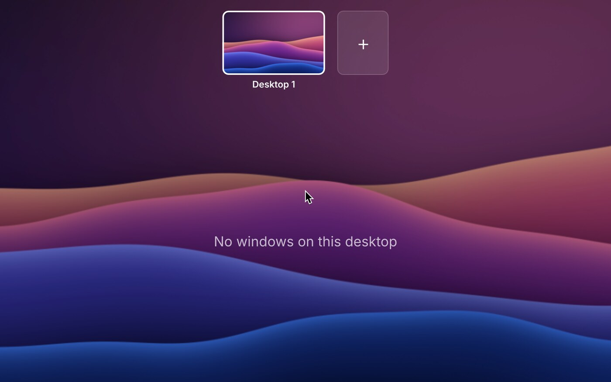

<h1 align="center">Cupertino for Omarchy</h1>

<p align="center">A macOS look and feel for <a href="https://omarchy.org">Omarchy</a>: menu bar, Dock, Spotlight, Launchpad, Mission Control, Control Center and working traffic lights.</p>

<p align="center">
  <a href="https://github.com/TudorG03/macos-omarchy-theme/actions/workflows/check.yml"></a>
  <a href="https://github.com/TudorG03/macos-omarchy-theme/releases/latest"></a>
  <a href="LICENSE"></a>
  
  
</p>



| Launchpad | Spotlight | Mission Control |
|---|---|---|
|  |  |  |

## Install

```bash
git clone https://github.com/TudorG03/macos-omarchy-theme.git
cd macos-omarchy-theme
./install.sh
```

Run it from inside your Omarchy desktop. It shows what it will do, asks once, and
takes about a minute. Run it again at any time to update.

| Option | Effect |
|---|---|
| `--yes` | Skip the confirmation |
| `--keep-terminal` | Keep your default terminal instead of switching to Ghostty |
| `--no-cursor` | Skip downloading the macOS cursor |

`omarchy theme install` is not enough for this theme. It drops `hyprland.lua` and
`ghostty.conf` from cloned themes, and it can't add plugins, hooks or icons.

Tested on Omarchy 4.0.6 with Hyprland 0.56.2. Other versions may need changes, because
the theme uses Hyprland's Lua config and Omarchy's shell plugin API.

## What you get

| Action | Shortcut |
|---|---|
| Launchpad | Tap `Super`, or `Super + Alt + Space` |
| Spotlight | `Super + Space` |
| Mission Control | `Super + grave`, or a hot corner |
| App Exposé | `Super + Shift + grave` |
| App Switcher | `Super + Tab`, then release `Super` |
| Close window | `Super + Q` |
| Dock | Move the pointer to the bottom edge |

Spotlight also does maths, unit and currency conversion, world clocks, file search and
`!bang` web searches.

Traffic lights appear on Ghostty and GTK apps. Red closes, yellow minimizes to the Dock,
and green switches a window between tiled and floating.

## What it changes

- **Added:** `~/.config/omarchy/themes/cupertino`, `~/.config/omarchy/plugins/cupertino.*`,
  `~/.config/omarchy/hooks/theme-set.d/cupertino`, and `~/.local/share/icons/Cupertino` and `macOS`.
- **While the theme is active:** the bar layout, GTK button layout, cursor,
  `~/.config/gtk-4.0/gtk.css` (only if you don't have your own) and Mac names for some apps,
  using marked copies in `~/.local/share/applications`.
- **Packages:** anything missing from `yaru-icon-theme`, `adwaita-fonts`,
  `ttf-jetbrains-mono-nerd`, `nautilus`, `gtk3`, `uwsm`, `networkmanager`, `bluez-utils`,
  `wireplumber`, `jq` and `ghostty`.

Switching to another theme undoes the "while active" changes, and switching back reapplies them.

## Uninstall

```bash
./uninstall.sh                     # returns to the theme you had before
./uninstall.sh --theme "Catppuccin" # or pick one
```

Installed packages are left in place.

## Customize

Edit the installed copies. Omarchy reloads plugins when you save them, but re-running
`install.sh` overwrites them.

- **Dock apps:** `pinCandidates` in `plugins/cupertino.dock/Service.qml`. Apps that aren't installed are skipped.
- **Shortcuts and window rules:** `theme/hyprland.lua`.
- **Colors:** `theme/colors.toml` and `theme/shell.*.toml`.

## Troubleshooting

- **The bar or volume popup looks stock:** run `omarchy restart shell`.
- **Traffic lights are missing in an open app:** restart the app.
- **Hyprland shows a config error:** check `hyprctl configerrors`, then run `./uninstall.sh` if needed.

## Contributing

Bug reports and pull requests are welcome. See [CONTRIBUTING.md](CONTRIBUTING.md).

## License

MIT, see [LICENSE](LICENSE). See [THIRD-PARTY-NOTICES.md](THIRD-PARTY-NOTICES.md) for third-party
code and trademarks. This is an unofficial fan project, not affiliated with Apple.
